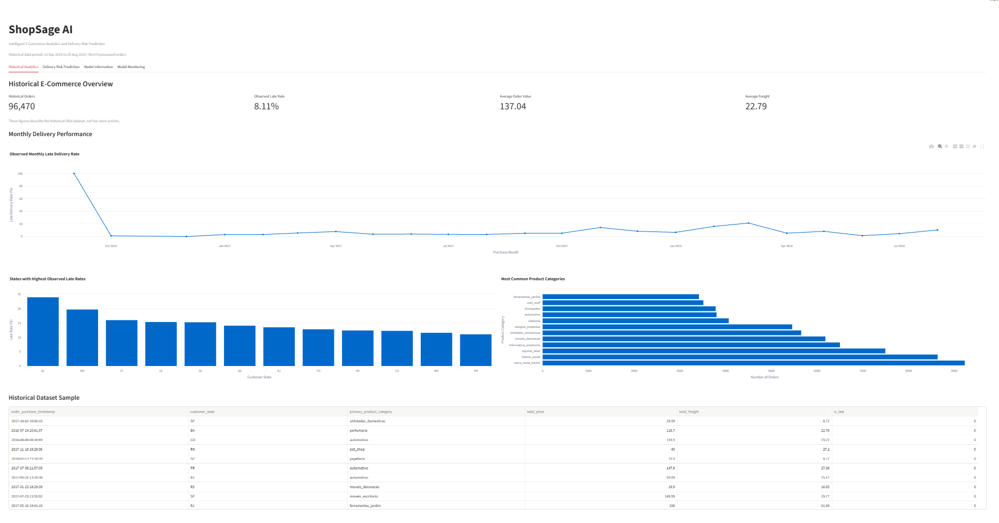
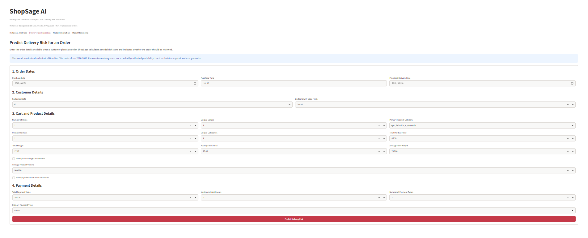
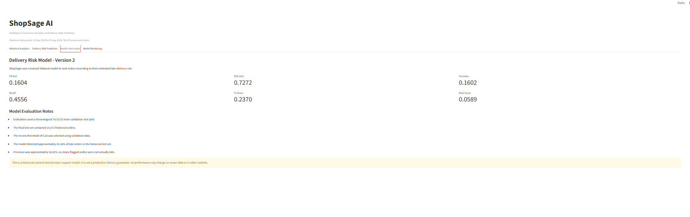
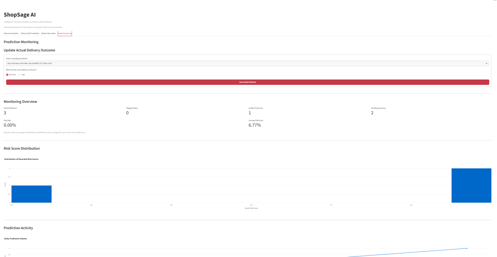

# ShopSage AI
### Intelligent E-Commerce Analytics and Delivery Risk Prediction

ShopSage AI is a machine learning-powered e-commerce analytics application that analyzes historical order data and predicts potential delivery risks. It combines historical business intelligence, predictive modeling, explainability, and prediction monitoring in an interactive Streamlit dashboard.

The project uses the Olist Brazilian E-Commerce dataset to explore delivery patterns, identify factors associated with late deliveries, and estimate delivery risk for new orders.

---

## Key Features

- **Historical Analytics:** Explore historical order trends, delivery performance, sales, and freight patterns.
- **Delivery Risk Prediction:** Predict potential delivery risks using a trained machine learning model.
- **Model Explainability:** Understand important features influencing delivery-risk predictions.
- **Model Information:** View model details, evaluation metrics, and training information.
- **Prediction Monitoring:** Store prediction records and track actual delivery outcomes.
- **Business Insights:** Analyze delivery performance across different business dimensions.
- **Interactive Dashboard:** Explore all functionalities through a Streamlit web application.

---

## Dashboard Screenshots

### 1. Historical Analytics

Explore historical e-commerce performance, order statistics, delivery trends, and business insights.



### 2. Delivery Risk Prediction

Enter order details and generate a machine learning-based delivery-risk prediction.



### 3. Model Information

Explore model details, performance metrics, and evaluation information.



### 4. Model Monitoring

Monitor saved predictions and review delivery outcomes when actual results are available.



---

## Model Performance

The selected model is **XGBoost Unweighted (V2)**, evaluated using a chronological train-validation-test split.

| Evaluation Metric | Test Result |
|---|---:|
| PR-AUC | 0.1604 |
| ROC-AUC | 0.7272 |
| Precision | 0.1602 |
| Recall | 0.4556 |
| F1 Score | 0.2370 |
| Brier Score | 0.0589 |
| Decision Threshold | 0.10 |

**Note:** The displayed prediction score is a model-generated risk ranking score. It should not be interpreted as a guaranteed delivery outcome or a calibrated real-world probability.

---

## Technology Stack

| Category | Technologies |
|---|---|
| Programming Language | Python |
| Data Processing | Pandas, NumPy |
| Machine Learning | Scikit-learn, XGBoost |
| Model Explainability | SHAP |
| Data Visualization | Matplotlib, Seaborn, Plotly |
| Dashboard | Streamlit |
| Model Storage | Joblib |
| Testing | Pytest |
| Development Environment | VS Code, Jupyter Notebook, Google Colab |
| Version Control | Git, GitHub |

---

## Project Structure

```text
ShopSage-AI/
│
├── app.py
├── requirements.txt
├── README.md
├── .env.example
├── .gitignore
│
├── screenshots/
│   ├── historical-analytics.png
│   ├── delivery-risk-prediction.png
│   ├── model-information.png
│   └── model-monitoring.png
│
├── data/
│   ├── raw/
│   ├── interim/
│   └── processed/
│
├── models/
│   └── best_delivery_model_v2.joblib
│
├── notebooks/
│   └── README.md
│
├── reports/
│   ├── business_insights_v2.txt
│   ├── calibration_metrics_v2.csv
│   ├── calibration_risk_groups_v2.csv
│   ├── model_comparison.csv
│   ├── training_metadata_v2.json
│   ├── shap_feature_importance_v2.csv
│   └── [Additional analysis reports and visualizations]
│
├── scripts/
│   ├── build_features.py
│   ├── check_data.py
│   ├── diagnose_data.py
│   ├── train_model.py
│   └── train_model_v2.py
│
├── src/
│   └── shopsage/
│       ├── __init__.py
│       ├── ai_agent.py
│       ├── config.py
│       ├── explain.py
│       ├── features.py
│       ├── monitoring.py
│       ├── predict.py
│       ├── preprocessing.py
│       └── train.py
│
└── tests/
    ├── test_app_import.py
    └── test_data.py
```

---

## Dataset

This project uses the **Olist Brazilian E-Commerce Public Dataset**.

- Source: Olist Brazilian E-Commerce Dataset
- Dataset size after feature engineering: 96,470 records
- Historical period: September 2016 – August 2018
- Target: Late delivery identification

The processed dataset and raw source data are not included in the GitHub repository.

Download the original dataset from Kaggle and place the required CSV files in the appropriate data directory before running the feature-engineering workflow.

---

## Installation and Setup

### 1. Clone the repository

```powershell
git clone https://github.com/Hrutuja21/ShopSage-AI.git
cd ShopSage-AI
```

### 2. Create a virtual environment

For Windows:

```powershell
py -3.13 -m venv .venv
```

### 3. Activate the environment

```powershell
.\.venv\Scripts\Activate.ps1
```

For Linux/macOS:

```bash
python3 -m venv .venv
source .venv/bin/activate
```

### 4. Install dependencies

```bash
python -m pip install --upgrade pip
python -m pip install -r requirements.txt
```

### 5. Prepare the dataset

Download the Olist dataset and place the required raw CSV files in the appropriate `data/raw/` directory.

The processed feature dataset is expected at:

```text
data/processed/olist_features.csv
```

The trained model artifact is expected at:

```text
models/best_delivery_model_v2.joblib
```

The processed dataset and trained model artifact may need to be supplied separately if they are not included in your repository checkout.

---

## Run the Application

Start the Streamlit dashboard:

```bash
python -m streamlit run app.py
```

Open the application in your browser:

```text
http://localhost:8501
```

---

## Run Tests

Execute the project tests using:

```bash
python -m pytest -v
```

---

## Machine Learning Workflow

The project follows these major steps:

1. **Data Preparation:** Load and inspect historical e-commerce data.
2. **Feature Engineering:** Generate relevant order, delivery, and time-based features.
3. **Model Training:** Train and compare machine learning models.
4. **Model Evaluation:** Evaluate models using PR-AUC, ROC-AUC, precision, recall, F1 score, and Brier score.
5. **Model Selection:** Select the V2 XGBoost model based on evaluation results.
6. **Prediction:** Generate delivery-risk scores for new order inputs.
7. **Explainability:** Analyze influential features using SHAP.
8. **Monitoring:** Log predictions and compare them with verified actual outcomes.

---

## Future Improvements

- Integrate real-time e-commerce order data.
- Explore additional machine learning algorithms.
- Improve model performance and risk detection.
- Extend prediction monitoring and reporting.
- Deploy the application to a cloud platform.
- Develop additional business intelligence features.

---

## Disclaimer

ShopSage AI is an academic and portfolio project developed for educational and analytical purposes.

Predictions are based on historical data and machine learning estimates. They do not guarantee actual delivery outcomes.

---

## Dataset Attribution

Olist Brazilian E-Commerce Public Dataset  
Source: Kaggle

---

## Author

**Hrutuja Atul Bhosale**

B.Tech – Computer Science and Engineering (Artificial Intelligence)

GitHub: [Hrutuja21](https://github.com/Hrutuja21)

Project Repository: [ShopSage AI](https://github.com/Hrutuja21/ShopSage-AI)